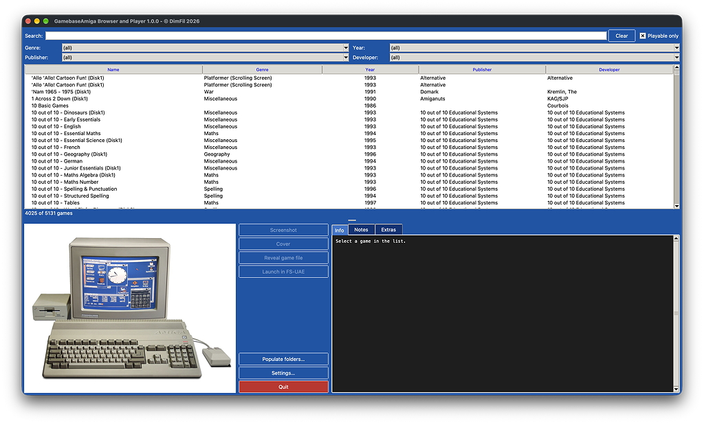
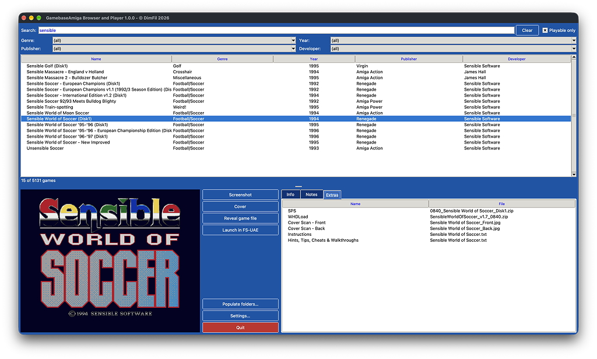
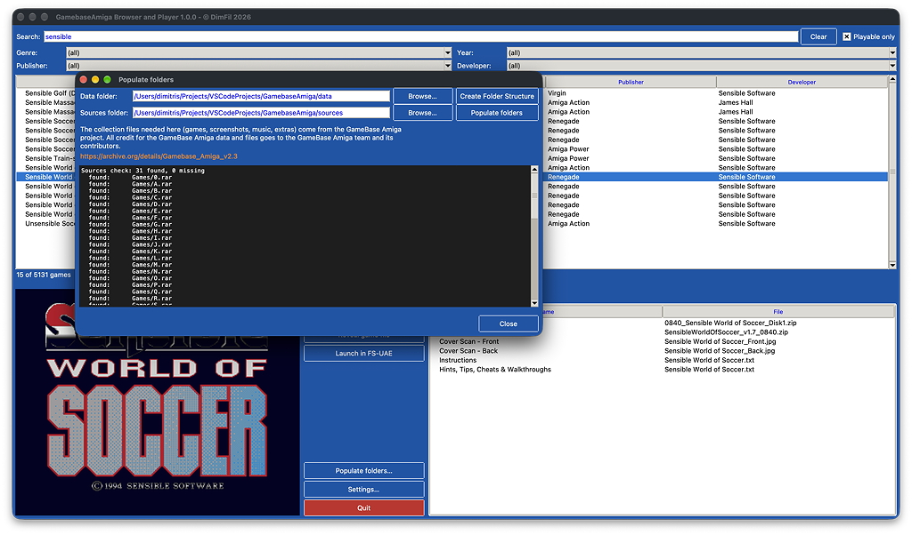
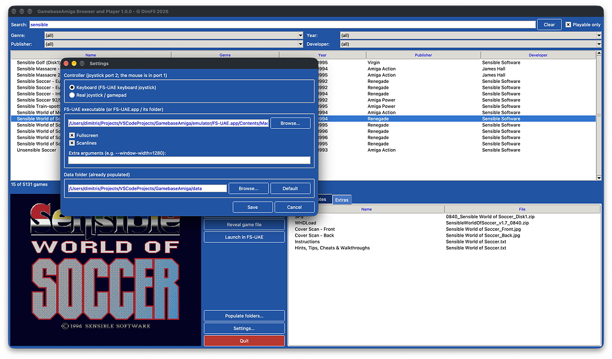
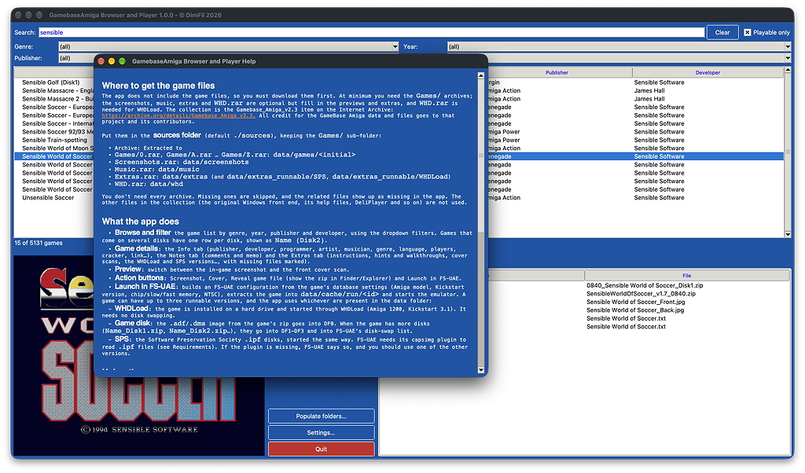
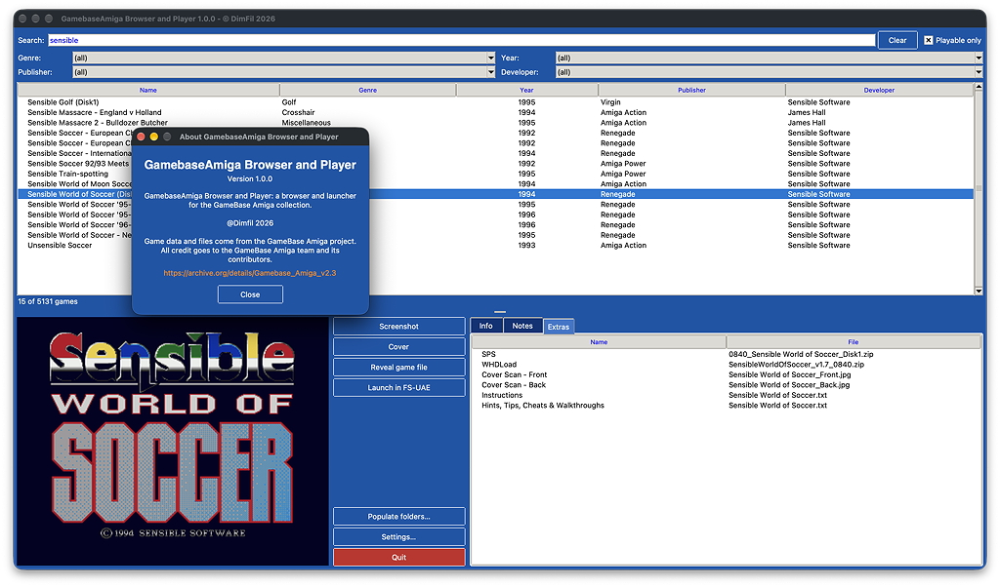
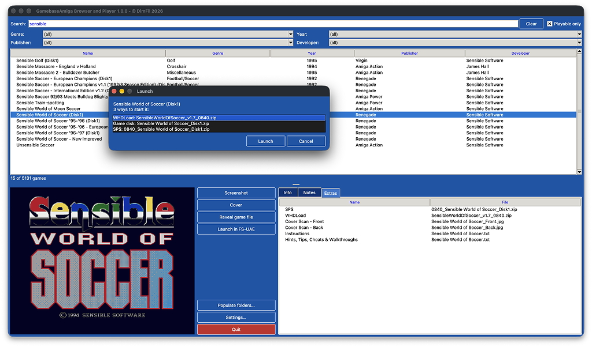

# GamebaseAmiga Browser and Player

GamebaseAmiga Browser and Player is a desktop browser and player for the **GameBase Amiga v2.3** collection of Commodore Amiga games. It reads the bundled game database (`gb_amiga_23.sqlite3`, converted from the original `gb_amiga_23.mdb` for easier access), shows each game's metadata, screenshot, cover and extras (manuals, hints, cover scans…), and launches games in the [FS-UAE](https://fs-uae.net/) emulator with one click.

The app does not ship the game files. You supply the GameBase Amiga source archives, and the app extracts them into a `data/` folder.

## Screenshots





| | |
|---|---|
|  |  |
|  |  |



## What the app does

- **Browse and filter** the game list by genre, year, publisher and developer, using the dropdown filters. Games that come on several disks have one row per disk, shown as `Name (Disk2)`.
- **Game details**: the *Info* tab (publisher, developer, programmer, artist, musician, genre, language, players, cracker, link…), the *Notes* tab (comments and memo) and the *Extras* tab (instructions, hints and walkthroughs, cover scans, the WHDLoad and SPS versions…, with missing files marked).
- **Preview**: switch between the in-game screenshot and the front cover scan.
- **Action buttons**: *Screenshot*, *Cover*, *Reveal game file* (show the zip in Finder/Explorer) and *Launch in FS-UAE*.
- **Launch in FS-UAE**: builds an FS-UAE configuration from the game's database settings (Amiga model, Kickstart version, chip/slow/fast memory, NTSC), extracts the game into `data/cache/run/<id>` and starts the emulator. A game can have up to three runnable versions, and the app uses whichever are present in the data folder:
  - **WHDLoad**: the game is installed on a hard drive and started through WHDLoad (Amiga 1200, Kickstart 3.1). It needs no disk swapping.
  - **Game disk**: the `.adf`/`.dms` image from the game's zip goes into DF0. When the game has more disks (`Name_Disk1.zip`, `Name_Disk2.zip`…), they go into DF1–DF3 and into FS-UAE's disk-swap list.
  - **SPS**: the Software Preservation Society `.ipf` disks, started the same way. FS-UAE needs its *capsimg* plugin to read `.ipf` files (see *Requirements*). If the plugin is missing, FS-UAE says so, and you should use one of the other versions.

## Using the app

- **Search**: type in the *Search* field above the list to filter games by name as you type. Click **Clear** to empty the field and show all games again.
- **Filters**: the dropdowns below the search box narrow the list by genre, year, publisher and developer. They combine with the search text.
- **Playable only**: ticked by default. The database lists 1,106 entries (other releases of a game, such as the extra *Ports of Call* rows) that have no game zip and no WHDLoad or SPS version, so nothing can be started for them. Untick the box to see them too.
- **Selecting a game**: click a game in the list to see its screenshot, details and extras. Buttons are greyed out when the matching file is missing.
- **Launching a game**: select it and click **Launch in FS-UAE**, or double-click it in the list. When the game has more than one runnable version, a window lets you pick one (WHDLoad is listed first). FS-UAE must be available (see *Settings*), and the game's files must be present in the data folder.
- **Launching a specific version**: in the *Extras* tab, double-click a WHDLoad or SPS entry to start exactly that one. Double-clicking any other extra opens it with the default application.
- **Quitting a game**: use FS-UAE's own quit key (press **F12**, then **Q**, or close the window). WHDLoad games also close FS-UAE when you quit the game.
- **Other buttons**: **Populate folders…** extracts the source archives, **Settings…** configures the controller, FS-UAE and data folder, and **Quit** closes the app.

## Requirements

- Python 3 with Tk (the standard `tkinter`)
- [Pillow](https://python-pillow.org/) (`pip install -r requirements.txt`)
- `unar` and `lsar`, the command line tools of [The Unarchiver](https://theunarchiver.com/command-line), to extract the `.rar` sources (`brew install unar` on macOS, `sudo apt install unar` on Linux). The app needs them only for **Populate folders…**.
- FS-UAE to launch games. Browsing works without it. The app looks for it in this order: `FSUAE_PATH`, the saved setting, the `emulator/` folder (for example `emulator/FS-UAE.app` on macOS), your `PATH`, and the usual install locations (`/Applications`, Homebrew, Program Files).
- The *capsimg* plugin, to read the `.ipf` disks of the SPS versions. It is not part of FS-UAE, and the repository does not include it. Download it from the [Software Preservation Society](http://www.softpres.org/) and put it in `emulator/System/CAPSImg/`, for example `emulator/System/CAPSImg/macOS/ARM64/capsimg.so` on an Apple Silicon Mac. FS-UAE finds it there on its own. Without it the `.adf` and WHDLoad versions still work.
- Kickstart ROMs in `emulator/Kickstarts/`. The repository does not include them, because Kickstart is copyrighted: supply your own dumps. The file names must contain the version, like `Kickstart v1.3 rev 34.5 (1987)(Commodore)(A500-A1000-A2000-CDTV).rom`. The app uses the version a game asks for, and otherwise the closest one: games that want 2.0 or newer get the oldest ROM from 2.0 up, and games that want 1.x get the newest 1.x ROM. **Kickstart 1.3** and **3.1** cover almost everything.

Run the app with a start script, which does the setup for you:

| System | Script |
|---|---|
| macOS | `start_macos.command` (double-click it in Finder) |
| Windows | `start_windows.bat` (double-click it) |
| Linux | `start_linux.sh` (run it from a terminal, or choose "Run" in your file manager) |

On the first run, the script creates a `.venv` virtual environment and installs `requirements.txt` into it. After that it only reinstalls when `requirements.txt` changes, and then starts the app. Python 3 with Tk must already be installed: the script tells you how to get it if it is missing.

Or start the app yourself:

```sh
python gamebaseamiga.py
```

`emulator/Portable.ini` is part of the repository, so FS-UAE always starts in portable mode when it is placed in `emulator/`: it keeps its own working folders (`Cache`, `Configurations`, `Save States`…) next to itself there instead of in your home folder. Keep that file when you replace or update FS-UAE.

## Populating the folders

The app finds files under a **data folder** (default `./data` next to the app). Its layout follows the paths stored in the database:

```
data/
├── games/              game zips, one folder per initial (0, A … Z)
├── screenshots/        in-game screenshots (same sub-folders)
├── music/              zipped music modules (same sub-folders)
├── extras/             Instructions, Hints, Cover Scans, MP3…
├── extras_runnable/    extras that can run in the emulator (SPS, WHDLoad)
├── whd/                the WHDLoad boot drive (C, Devs, Libs, S)
├── covers/             optional generated front covers ({GA_Id}.jpg)
└── cache/              temporary disk images and drives created at launch
```

### 1. Get the source archives

The app does not include the game files, so you must download them first. At minimum you need the `Games/` archives; the screenshots, music, extras and `WHD.rar` are optional but fill in the previews and extras, and `WHD.rar` is needed for WHDLoad. The collection is the *Gamebase_Amiga_v2.3* item on the Internet Archive: <https://archive.org/details/Gamebase_Amiga_v2.3>. All credit for the GameBase Amiga data and files goes to that project and its contributors.

Put them in the **sources folder** (default `./sources`), keeping the `Games/` sub-folder:

| Archive | Extracted to |
| --- | --- |
| `Games/0.rar`, `Games/A.rar` … `Games/Z.rar` | `data/games/<initial>` |
| `Screenshots.rar` | `data/screenshots` |
| `Music.rar` | `data/music` |
| `Extras.rar` | `data/extras` (and `data/extras_runnable/SPS`, `data/extras_runnable/WHDLoad`) |
| `WHD.rar` | `data/whd` |

You don't need every archive. Missing ones are skipped, and the related files show up as missing in the app. The other files in the collection (the original Windows front end, its help files, DeliPlayer and so on) are not used.

### 2. Extract them

**From the app:** click **Populate folders…**.

1. Optionally pick a different *Data folder* and *Sources folder* with **Browse…**. The dialog checks the sources folder straight away and lists each expected archive as found, MISSING, UNREADABLE or not needed.
2. Click **Create Folder Structure** to create the empty `data/` tree.
3. Click **Populate folders** to extract the archives. Progress appears in the log.

**From the command line:**

```sh
python populate.py --dry-run   # show what would be extracted
python populate.py             # extract
python data_audit.py           # just create the folder tree
```

Re-running is safe. Files that already exist with the same size are skipped, so an interrupted run can simply be started again, and unsafe archive paths are ignored. Extracting everything needs roughly 9 GB, mostly from `Extras.rar`.

On first start, if `data/games` holds no files, the app tells you the data needs populating.

Names are matched case-insensitively and ignore macOS/Windows Unicode differences, so a collection extracted on one OS works on another. On a case-insensitive file system, a handful of screenshots whose names differ only in `ß` versus `ss` share one file.

## Settings

Open **Settings…** from the main window. Everything is saved in `config.json` next to the app.

| Setting | What it does |
| --- | --- |
| **Controller** | *Keyboard* uses FS-UAE's keyboard joystick. *Joystick* uses a real gamepad or joystick. Either one goes in joystick port 2, and the mouse is in port 1. |
| **FS-UAE executable** | Path to the FS-UAE executable, `FS-UAE.app` or its folder. If it is empty, the app searches the places listed under *Requirements*. |
| **Fullscreen** | Start FS-UAE fullscreen or in a window. |
| **Scanlines** | Draw CRT-style scanlines (FS-UAE's `scanlines` option). On by default. |
| **Extra arguments** | Added to the FS-UAE command line, for example `--window-width=1280`. |
| **Data folder** | Point the app at a data folder elsewhere, for example on an external drive. If the new folder has no structure or no game files, the app offers to open the *Populate folders* window for it. |

## Building a standalone app

```sh
pip install pyinstaller pillow
python build.py
```

This builds with PyInstaller into `dist/`, and copies `gb_amiga_23.sqlite3` and the `emulator/` folder (without the Kickstart ROMs) next to the app. The large game data is not bundled. Choose its folder in Settings, or place it next to the app as `data/`.

## Credits

- Game data and files: the GameBase Amiga project and its contributors (Internet Archive link above).
- Start-up picture (`images/amiga.jpg`): "Amiga500 system" from [Wikimedia Commons](https://commons.wikimedia.org/wiki/File:Amiga500_system.jpg), licensed [CC BY-SA 2.5](https://creativecommons.org/licenses/by-sa/2.5/). Resized.
- Emulator: [FS-UAE](https://fs-uae.net/), which builds on the UAE core.

## License

The code is released under the [MIT License](LICENSE). The start-up picture is under its own license (CC BY-SA 2.5). The GameBase Amiga data is covered by its own terms, as described in Credits.
